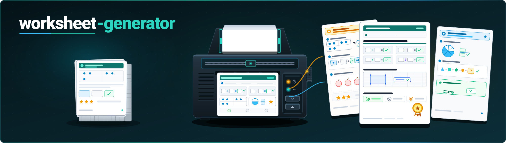
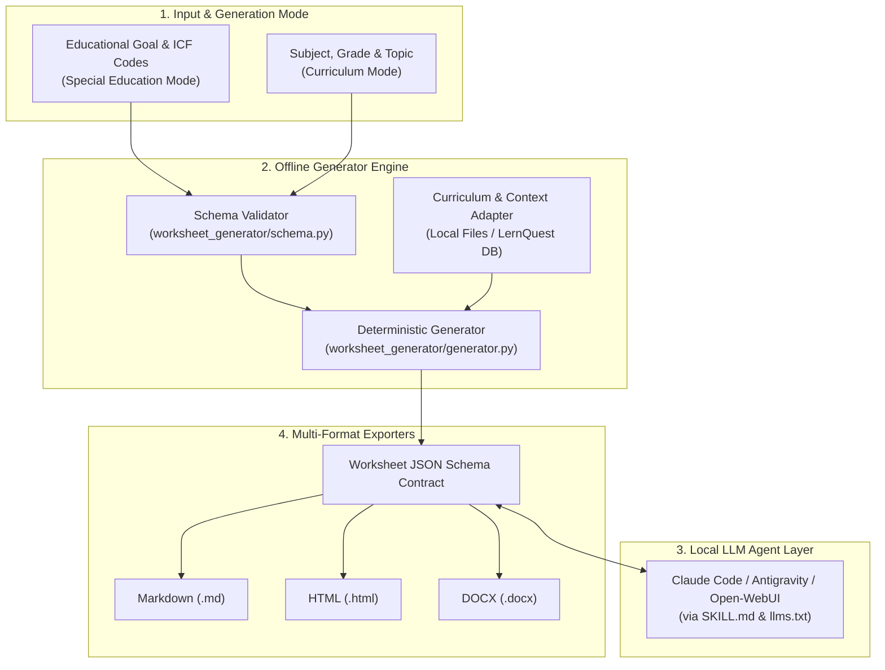
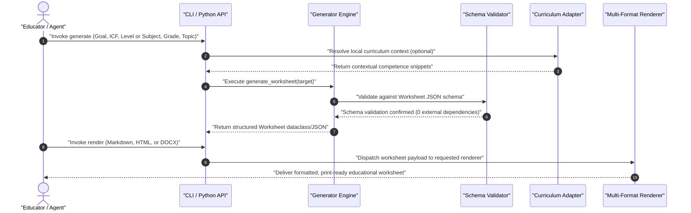

# worksheet-generator

<p align="center">
  <a href="LICENSE"></a>
  <a href="https://www.python.org/downloads/"></a>
  <a href="https://github.com/ellmos-ai/worksheet-generator/actions"></a>
  <a href="tests/"></a>
  <a href="#why-worksheet-generator"></a>
  <a href="#security--system-invariants"></a>
  <a href="https://github.com/ellmos-ai"></a>
  <a href="https://github.com/open-bricks"></a>
  <a href="llms.txt"></a>
  <a href="README_de.md"></a>
</p>

<p align="center">
  <a href="README.md">English</a> | <a href="README_de.md">Deutsch</a> | <b>Español</b>
</p>

> Esta es una traducción de la documentación; no implica que el producto o su entorno de ejecución ofrezcan una interfaz en español.

> [!NOTE]
> **Integración con agentes de IA y LLM:** `worksheet-generator` proporciona especificaciones legibles por máquina ([`llms.txt`](llms.txt), [`SKILL.md`](SKILL.md) y esquemas de la biblioteca estándar en `worksheet_generator/schema.py`) diseñados para integrarse sin fricciones con agentes locales (Claude Code, Antigravity, Open-WebUI) y automatizar la generación, diferenciación y enriquecimiento de materiales.

> [!IMPORTANT]
> **Privacidad y funcionamiento sin conexión (sin tráfico de red saliente):** El motor de generación funciona completamente sin conexión y **no procesa datos de clientes ni datos personales**: se controla exclusivamente mediante objetivos educativos abstractos, códigos ICF o currículos escolares. La única excepción es el ayudante opcional `_tools/icf_fetch.py --who-api`, que consulta la API de la OMS para obtener títulos breves de la ICF solo si lo ejecutas expresamente (consulta la [referencia de la ICF](#icf-reference--bring-your-own-model)).

> [!TIP]
> **Integración con el ecosistema:** Funciona directamente con otras herramientas de `ellmos-ai`, como [report-forge](https://github.com/ellmos-ai/report-forge) (canalizaciones de informes anonimizados), [USMC](https://github.com/ellmos-ai/usmc) (memoria compartida de agentes) y [ellmos-homebase-mcp](https://github.com/ellmos-ai/ellmos-homebase-mcp).

---

<a id="quick-navigation"></a>
## Navegación rápida

1. [¿Qué es worksheet-generator?](#what-is-worksheet-generator)
2. [Perfiles destinatarios y facilidad de descubrimiento](#target-personas--discoverability)
3. [Arquitectura y flujo del sistema](#architecture--system-flow)
4. [Ciclo de generación y exportación](#generation--export-lifecycle)
5. [Matriz comparativa frente a alternativas](#comparative-matrix-vs-alternatives)
6. [Capacidades principales y modos duales](#core-capabilities--dual-modes)
7. [Primeros pasos e instalación](#getting-started--installation)
8. [Uso y flujo de trabajo](#usage--workflow)
9. [Referencia de comandos de CLI](#cli-command-reference)
10. [Renderizadores y formatos de exportación](#export-renderers--formats)
11. [Configuración y anulaciones locales](#configuration--local-overrides)
12. [Contexto curricular y adaptadores](#curriculum-context--adapters)
13. [Referencia de la ICF y modelo propio](#icf-reference--bring-your-own-model)
14. [Integración con agentes de IA y LLM](#ai-agent--llm-integration)
15. [Licencias de terceros y transparencia](#third-party-licenses--transparency)
16. [Pruebas de contrato y verificación](#contract-tests--verification)

<a id="why-worksheet-generator"></a>
<a id="security--system-invariants"></a>
<a id="what-is-worksheet-generator"></a>
## ¿Qué es worksheet-generator?

**worksheet-generator** es un motor local, de uso sin privilegios, que genera hojas de trabajo estructuradas e individualizadas para profesionales de educación especial, terapeutas y docentes. Conecta la planificación estructurada de objetivos educativos con la generación automatizada de materiales didácticos:

- **Modo de educación especial:** Genera materiales de práctica específicos a partir de objetivos educativos abstractos, códigos ICF (por ejemplo, `d150` para calcular y `b140` para funciones de atención), niveles de diferenciación (por ejemplo, `einfache_sprache`, `anschaulich`) y grupos de edad destinatarios.
- **Modo curricular:** Genera hojas de trabajo por asignatura a partir de materias escolares, cursos, temas y niveles de dificultad graduados (básico / medio / avanzado — G/M/E).
- **Exportación multiformato:** Produce documentos validados en JSON, Markdown, HTML limpio y DOCX opcional.
- **Cero dependencias obligatorias:** Está construido íntegramente con la biblioteca estándar de Python 3.10 o posterior.

> **Aviso:** Este módulo es un *generador de materiales*, no un programa terapéutico ni una garantía de éxito del tratamiento. No sustituye el criterio diagnóstico o pedagógico profesional: revisa y adapta siempre los materiales generados antes de utilizarlos en el aula o en un entorno clínico.

<a id="target-personas--discoverability"></a>
## Perfiles destinatarios y facilidad de descubrimiento

`worksheet-generator` está diseñado para cuatro perfiles principales:

### `[PERSONA-01]` Docentes de educación especial y educadores de apoyo
- **Contexto:** Trabajan en centros de educación especial, aulas inclusivas o centros de apoyo educativo.
- **Necesidad:** Ejercicios muy individualizados y graduales, alineados con planes educativos individuales (IEP) y objetivos de desarrollo de la ICF.
- **Por qué sirve esta herramienta:** Evita horas de diferenciación manual y mantiene los planes confidenciales de aprendizaje del alumnado en el equipo local.

### `[PERSONA-02]` Logopedas y terapeutas ocupacionales
- **Contexto:** Trabajan en consultas privadas, centros de pediatría social (SPZ) o clínicas pediátricas.
- **Necesidad:** Hojas de práctica específicas y adecuadas a la edad para habilidades cognitivas, fonológicas o de motricidad fina.
- **Por qué sirve esta herramienta:** Cumple estrictamente los requisitos de confidencialidad médica y del RGPD; la parametrización de objetivos abstractos garantiza que no se usen datos identificativos de pacientes.

### `[PERSONA-03]` Ingenieros de agentes de IA y arquitectos de canalizaciones
- **Contexto:** Diseñan sistemas locales multiagente con Claude Code, Antigravity, Open-WebUI o LangGraph.
- **Necesidad:** Contratos deterministas de esquemas JSON, validación con la biblioteca estándar (`schema.py`) y contexto legible por máquina (`llms.txt`, `SKILL.md`).
- **Por qué sirve esta herramienta:** Ofrece un esquema central robusto y no alucinatorio que los agentes pueden inspeccionar, completar, enriquecer y convertir mediante código, sin fragilidad en tiempo de ejecución.

### `[PERSONA-04]` Docentes de aula ordinaria y jefaturas de departamento
- **Contexto:** Enseñan en grupos heterogéneos de primaria, secundaria o bachillerato.
- **Necesidad:** Generar rápidamente hojas de práctica graduadas (niveles G, M, E) de matemáticas, alemán o ciencias, sin depender de un proveedor.
- **Por qué sirve esta herramienta:** Es una herramienta gratuita y de código abierto (MIT), genera Markdown y HTML al instante y funciona sin costosas suscripciones en la nube.

<a id="architecture--system-flow"></a>
## Arquitectura y flujo del sistema




<a id="generation--export-lifecycle"></a>
## Ciclo de generación y exportación




<a id="comparative-matrix-vs-alternatives"></a>
## Matriz comparativa frente a alternativas

| Función / dimensión | worksheet-generator | Worksheet Crafter | ChatGPT / LLM en la nube | Eduki / portales de materiales | Plantillas DOCX manuales |
|---|---|---|---|---|---|
| **1. Privacidad y sin tráfico de red saliente** | **100 % local / sin conexión** | Aplicación de escritorio local | Nube (salida externa de datos) | Mercado en la nube | Local |
| **2. Integración de objetivos ICF** | **Parámetro nativo** | Solo texto manual | Depende de las instrucciones | Estática / poco frecuente | Ninguna |
| **3. Contrato de esquema legible por máquina** | **JSON estándar (`schema.py`)** | Binario propietario | Texto no estructurado | Ninguno (PDF/DOCX) | Ninguno |
| **4. Preparado para canalizaciones de agentes de IA** | **Nativo (`llms.txt`, `SKILL.md`)** | Ninguna | Solo API web | Ninguno | Ninguno |
| **5. Diferenciación por niveles** | **Automática (G/M/E)** | Diseño manual | Depende de las instrucciones | Archivos separados | Manual |
| **6. Renderizado multiformato** | **MD, HTML, DOCX** | PDF, propietario | Solo Markdown | Principalmente PDF | Solo DOCX |
| **7. Dependencias obligatorias** | **Cero (biblioteca estándar de Python)** | Entorno nativo C++/Qt | Suscripción a la nube | Navegador / inicio de sesión | Licencia de MS Office |
| **8. Telemetría y cuentas de usuario** | **Ninguna (RunAsInvoker)** | Validación de licencia | Cuenta obligatoria | Cuenta obligatoria | Ninguna |
| **9. Adaptadores de contexto extensibles** | **Sí (`curriculum_sources`)** | Ninguno | Se necesita una canalización RAG | Ninguno | Ninguno |
| **10. Modelo de licencia** | **Código abierto MIT** | Suscripción comercial | Suscripción SaaS | Pago por elemento | Propietario |

<a id="core-capabilities--dual-modes"></a>
## Capacidades principales y modos duales

| Función | Descripción |
|---|---|
| **Privacidad y RGPD** | Motor local y sin conexión. No procesa datos personales ni de clientes. |
| **Modo de educación especial** | Genera ejercicios a partir de descripciones de objetivos, códigos ICF, niveles de diferenciación y grupos de edad. |
| **Modo curricular** | Genera hojas de trabajo a partir de una materia escolar, curso, tema y dificultad graduada (G/M/E). |
| **Exportación multiformato** | Exportación integrada a Markdown y HTML limpio; exportación opcional a DOCX. |
| **Preparado para agentes de IA** | Especificaciones legibles por máquina para Claude Code, Antigravity y canalizaciones autónomas de LLM. |

<a id="getting-started--installation"></a>
## Primeros pasos e instalación

No hay dependencias externas obligatorias: solo la biblioteca estándar de Python (Python >= 3.10):

```bash
# Clone the repository
git clone https://github.com/ellmos-ai/worksheet-generator.git
cd worksheet-generator

# Install in editable mode
pip install -e .
```


Dependencias opcionales para renderizar DOCX o ejecutar las suites de pruebas:

```bash
# For Microsoft Word (.docx) export:
pip install -e ".[docx]"

# For development and tests:
pip install -e ".[test]"
```


<a id="usage--workflow"></a>
## Uso y flujo de trabajo

### Uso de la biblioteca de Python

```python
from worksheet_generator import Foerderziel, generate_worksheet, save_worksheet
from worksheet_generator import renderers

# 1. Define educational or therapeutic target
ziel = Foerderziel(
    freitext="Mengen bis 10 erfassen",
    icf_codes=["d150"],
    niveau="einfache_sprache",
    alter="8",
    thema="mathe",
)

# 2. Deterministic worksheet generation
worksheet = generate_worksheet(ziel)

# 3. Persist JSON schema contract
save_worksheet(worksheet, "output/worksheet.json")

# 4. Render to Markdown or HTML
md_output = renderers.to_markdown(worksheet)
html_output = renderers.to_html(worksheet)
print(md_output)
```


<a id="cli-command-reference"></a>
## Referencia de comandos de CLI

La interfaz de línea de comandos se puede ejecutar como `worksheet-generator` o con `python -m worksheet_generator`:

```bash
# Generate in Special Education mode (Goal & ICF)
worksheet-generator generate \
  --freitext "Mengen bis 10 erfassen" \
  --icf d150 \
  --niveau einfache_sprache \
  --alter 8 \
  --thema mathe \
  --out output/worksheet.json

# Generate in School Curriculum mode
worksheet-generator generate \
  --subject Mathematik \
  --grade 3 \
  --topic "Einmaleins" \
  --out output/ab_mathe.json

# Render JSON to Markdown
worksheet-generator render output/worksheet.json --format md

# Render JSON to HTML
worksheet-generator render output/worksheet.json --format html --out output/worksheet.html

# Render JSON to DOCX (requires python-docx)
worksheet-generator render output/worksheet.json --format docx --out output/worksheet.docx

# Inspect environment and renderer status
worksheet-generator status
```


<a id="export-renderers--formats"></a>
## Renderizadores y formatos de exportación

| Renderizador | Estado | Dependencias | Características de la salida |
|---|---|---|---|
| **Markdown** | Núcleo, integrado | Biblioteca estándar | Markdown limpio con sabor a GitHub, adecuado para terminal, Obsidian o web. |
| **HTML** | Núcleo, integrado | Biblioteca estándar | HTML semántico con estilos limpios de impresión integrados (`@media print`). |
| **DOCX** | Núcleo, opcional | `pip install python-docx` | Documento Word editable con encabezados con formato, bloques de ejercicios y soluciones. |
| **PDF** | Externo | Impresión HTML / WeasyPrint | Primero se renderiza como HTML y después se imprime a PDF con un navegador o Chrome sin interfaz gráfica. |

<a id="configuration--local-overrides"></a>
## Configuración y anulaciones locales

La configuración predeterminada está integrada en `worksheet_generator/default_config.json` y reflejada en `config.json`.
Las anulaciones locales sin versionar van en `config.local.json` (ignorado por Git; plantilla: `config.local.example.json`):

```json
{
  "default_niveau": "einfache_sprache",
  "default_alter": "8-10",
  "curriculum_sources": {
    "local_files": "path/to/curricula"
  }
}
```


<a id="curriculum-context--adapters"></a>
## Contexto curricular y adaptadores

El indicador `--subject` activa el modo curricular. Los adaptadores de contexto permiten leer extractos curriculares locales como contexto de referencia:
- `local-files`: Lee extractos Markdown o JSON de las carpetas locales que hayas designado.
- `lernquest`: Adaptador experimental que lee en modo de solo lectura un registro local de competencias SQLite mediante `LERNQUEST_DB`.

Los extractos sirven como contexto para las instrucciones y la generación, no como fuentes curriculares oficiales o jurídicamente vinculantes.

<a id="icf-reference--bring-your-own-model"></a>
## Referencia de la ICF y modelo propio

> **Aviso:** Este repositorio no incluye textos completos de la ICF, descripciones diagnósticas ni títulos breves. Los códigos ICF (`d150`, `b140`, etc.) se procesan estrictamente como identificadores alfanuméricos abstractos.

El ayudante opcional `_tools/icf_fetch.py` permite crear un archivo local `icf_local.json`, ignorado por Git:
- **Modo A (sin conexión):** Proporciona tu propio archivo de origen CSV/JSON (`--source`).
- **Modo B (API de la OMS):** Consulta la API oficial de la OMS para ICD-11 / ICF con tus propias credenciales gratuitas de desarrollador.

ICF © Organización Mundial de la Salud (OMS); edición alemana © OMS / BfArM. **La licencia MIT de este repositorio no cubre los textos de la clasificación ICF.**

<a id="ai-agent--llm-integration"></a>
## Integración con agentes de IA y LLM

`worksheet-generator` está optimizado para agentes de IA autónomos:
- [`llms.txt`](llms.txt): Resumen legible por máquina de los comandos de CLI, esquemas y estructura de archivos.
- [`SKILL.md`](SKILL.md): Instrucción práctica para agentes Claude Code, Antigravity y orquestadores de cadenas de herramientas.
- **Flujo de trabajo:** Un agente ejecuta `worksheet-generator generate` para crear el JSON base, enriquece el contenido de los ejercicios con capacidades locales de LLM y ejecuta `worksheet-generator render` para generar documentos imprimibles finales.

<a id="third-party-licenses--transparency"></a>
## Licencias de terceros y transparencia

La auditoría completa de licencias y la información de transparencia se mantienen en [`THIRD_PARTY_LICENSES.md`](THIRD_PARTY_LICENSES.md):
- **Entorno de ejecución principal:** Biblioteca estándar de Python (`PSF-2.0`). Cero dependencias externas obligatorias en tiempo de ejecución.
- **Dependencias opcionales:** `python-docx` (`MIT`).
- **Herramientas de desarrollo y pruebas:** `pytest` (`MIT`), `setuptools` (`MIT`).
- **Materiales generados:** Garantía de cero copyleft al 100 % para los documentos de usuario generados.

<a id="contract-tests--verification"></a>
## Pruebas de contrato y verificación

La suite de pruebas verifica la paridad de metadatos, la integridad del descubrimiento de paquetes, los esquemas y el renderizado:

```bash
PYTHONIOENCODING=utf-8 python -m pytest tests/ -v
```


27 pruebas verifican:
- Contratos de licencia y descubrimiento de paquetes PEP 639 y PEP 621 (`tests/test_metadata.py`).
- Validación de esquemas y casos negativos de error (`tests/test_smoke.py`).
- Modos de generación de educación especial y currículo (`tests/test_curriculum.py`).
- Corrección y escapado de la exportación a Markdown y HTML.

<a id="ecosystem--sister-projects"></a>
## Ecosistema y proyectos relacionados

Forma parte de los ecosistemas **ellmos-ai** y **open-bricks**:
- [report-forge](https://github.com/ellmos-ai/report-forge): Generación de informes anonimizados y canalizaciones de documentos.
- [clirec](https://github.com/ellmos-ai/clirec): Grabación y reproducción de demostraciones de terminal e interfaz gráfica.
- [USMC](https://github.com/ellmos-ai/usmc): Cliente de memoria compartida de agentes para el ecosistema ellmos.
- [ellmos-homebase-mcp](https://github.com/ellmos-ai/ellmos-homebase-mcp): Servidor local de memoria, conocimiento y orquestación de enjambres para LLM.

<a id="license--disclaimer"></a>
## Licencia y descargo de responsabilidad

- **Licencia:** Licencia MIT (consulta [LICENSE](LICENSE)).
- **Aviso médico y educativo:** Este software es una herramienta para generar materiales, no un producto sanitario de diagnóstico ni un currículo terapéutico pedagógico certificado. Profesionales cualificados deben revisar todos los materiales antes de utilizarlos en clase.
